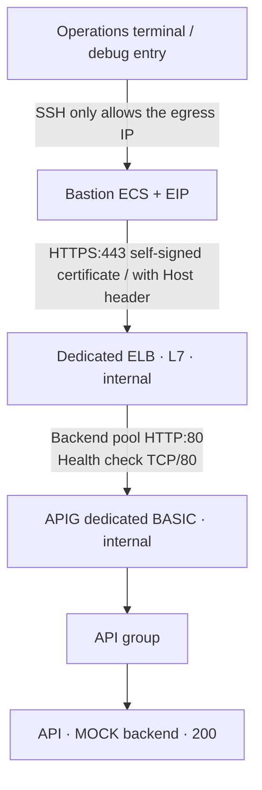

# cloud-native-security-private-api-gateway


## 1. Overview

This practice provides a reference implementation on Huawei Cloud for an "API Gateway with zero public-network entry, reachable only through an internal Layer-7 load balancer."

The problem it solves: some workloads require that the API Gateway is never exposed to the public network, and external callers can only enter through a private link. This solution uses a **dedicated Elastic Load Balance (L7 / internal / HTTPS)** as the only entry point, with an **API Gateway (APIG) dedicated instance (internal only)** as the backend, which then routes to a MOCK backend through an API group, with end-to-end HTTPS.

Target audience: architects, operators, and engineers who need to implement the "private API Gateway" pattern on Huawei Cloud and want to understand the APIG dedicated internal ingress and the ELB Host forwarding mechanism.

---

## 2. Table of Contents

- [1. Overview](#1-overview)
- [2. Table of Contents](#2-table-of-contents)
- [3. Architecture Diagram](#3-architecture-diagram)
- [4. Highlights](#4-highlights)
- [5. Cloud Services Used](#5-cloud-services-used)
- [6. Prerequisites](#6-prerequisites)
- [7. Quick Start](#7-quick-start)
- [8. Step-by-Step Deployment](#8-step-by-step-deployment)
- [9. Usage / Verification](#9-usage--verification)
- [10. Cleanup](#10-cleanup)
- [11. Detailed Explanation](#11-detailed-explanation)
- [12. Dependencies](#12-dependencies)
- [13. FAQ / Troubleshooting](#13-faq--troubleshooting)
- [14. Contributing](#14-contributing)
- [15. License](#15-license)
- [16. Contact / Maintainers](#16-contact--maintainers)

---

## 3. Architecture Diagram



The entire link has only one external entry point: the internal IP of the ELB. The API Gateway instance is not bound to an EIP and has no public entry; its internal ingress address is exported directly by `huaweicloud_apig_instance` (`vpc_ingress_address`).

---

## 4. Highlights

- **API Gateway with zero public entry**: the dedicated instance is deployed in a user VPC subnet; without an EIP it is purely internal and needs no additional private access resources.
- **Client → ELB is HTTPS, ELB → APIG is internal HTTP**: the ELB listener terminates TLS on HTTPS:443 with a certificate (self-signed in this practice; replace with a trusted CA in production); the APIG internal ingress listens only on port 80 (port 443 requires a bound certificate), so the origin fetch uses HTTP:80, which is sufficient within the VPC.
- **Host header forwarding**: the listener uses `forward_host = true` to pass the client's original Host to APIG; APIG routes to the API group by Host, leaving no ambiguity in the chain.
- **Health check over TCP/80**: it only verifies that the APIG internal ingress port is listening, without depending on Host routing, avoiding pitfalls such as "HTTPS requires a bound certificate" and "the Host header is not honored for HTTP health checks"; the actual 200 is verified end-to-end by the caller's `curl` (with `-k` and a Host header).
- **Source convergence**: a dedicated ELB has no security group; access control is delegated to a listener-level IP address group allowlist (`ip_group`) to restrict the source CIDRs that can reach the listener.
- **Pinned specification, reproducible**: the ELB flavor is locked exactly by name (`L7_flavor.elb.s1.small`); random selection by data-source index is forbidden.

---

## 5. Cloud Services Used

This practice uses the following Huawei Cloud services:

| Service | Purpose |
|---|---|
| VPC | Client / bastion / APIG subnets |
| ECS (Elastic Cloud Server) | Bastion host for verification inside the VPC |
| Dedicated ELB (Elastic Load Balance) | Only internal L7/HTTPS entry point |
| API Gateway (APIG) dedicated edition | Private API Gateway instance |
| EIP (Elastic IP) | Bastion outbound access (SSH login) |

---

## 6. Prerequisites

- **Account and permissions**: deployment permission in the `cn-south-1` (CN South-Guangzhou) region, with the ability to create VPC, APIG dedicated edition, ELB, ECS, and EIP.
- **CLI tools**:
- Terraform `>= 1.4.0` (this practice uses `1.x`, 1.5+ recommended)
- `huaweicloud` Provider `>= 1.90.0` (this practice pins 1.96.1)
- `tls` Provider `>= 4.0.0`, `random` Provider `>= 3.5.0`
- **Access key configuration**: AK/SK are provided through environment variables and must never be written to any file (see Quick Start below).
- **Regional constraints**: the flavor catalogs of APIG dedicated edition and ELB differ slightly by region; the number of availability zones is an ELB flavor multiplier, with a single AZ by default.

---

## 7. Quick Start

```bash
# 1) Configure access keys AK/SK (current shell only)
export HW_ACCESS_KEY="<HW_ACCESS_KEY>"
export HW_SECRET_KEY="<HW_SECRET_KEY>"
export HW_REGION_NAME="cn-south-1"

# 2) Enter the directory and initialize
cd infra
terraform init

# 3) Preview (optional)
terraform plan

# 4) Deploy
terraform apply

# 5) Get the verification command
terraform output verify_command
```

> Credentials are always represented by the placeholders `<HW_ACCESS_KEY>` / `<HW_SECRET_KEY>`; real values are never written to files or documentation.

---

## 8. Step-by-Step Deployment

1. **Prepare `terraform.tfvars`** (already in the repository, containing `region`, `name_prefix`, and the bastion SSH source CIDR):
```hcl
region = "cn-south-1"
name_prefix = "cf2privapi"
bastion_ssh_source_cidr = "<your egress IP>/32" # must be set explicitly; 0.0.0.0/0 is not accepted
```
2. **`terraform init`** — pull the `huaweicloud` / `tls` / `random` Providers.
3. **`terraform plan`** — expect about 26 resources (including the bastion). Confirm in particular:
- `huaweicloud_apig_instance.this` has no `eip_id` set (stays private);
- `huaweicloud_elb_loadbalancer.this` has an `l7_flavor_id` that matches a unique flavor;
- the image architecture of `huaweicloud_compute_instance.bastion` is `x86` (consistent with s6.small.1).
4. **`terraform apply`** — creating an APIG dedicated instance takes about 20–30 minutes; please wait patiently. ELB / ECS are faster.
5. **Review outputs**: `terraform output` (see [Usage / Verification](#9-usage--verification)).

---

## 9. Usage / Verification

### Usage and Verification

After deployment, run the verification commands on the **bastion host** (inside the VPC) to confirm the link works end-to-end:

```bash
# Positive case: reach the MOCK API through the internal ELB
$(terraform output -raw verify_command)
# i.e.:
# curl -sS -k -i -H 'Host: <group debug domain>' https://<ELB internal IP>/hello

# Negative case: direct access to the APIG internal ingress should also work (proving the gateway is internally reachable)
$(terraform output -raw negative_check_command)
```

Expected response:

```
HTTP/1.1 200 OK
...
{"message": "Hello from API GW"}
```

Meaning of key outputs:

| Output | Description |
|---|---|
| `apig_private_ingress_address` | APIG internal ingress address (the ELB backend points to it) |
| `api_group_domain` | API group debug domain, **which must be passed as the Host header when calling** |
| `elb_private_ip` | Private IP of the internal ELB, the only external entry point |
| `apig_public_ingress_address` | Should be empty; a non-empty value means the gateway was mistakenly bound to an EIP and the architectural constraint is broken |
| `bastion_public_ip` / `bastion_password` | Bastion login information (password is sensitive) |

After deployment, follow these steps to verify that the business functionality works before considering the delivery complete.

---

## 10. Cleanup

After debugging, destroy the resources to release this deployment:

```bash
cd infra
terraform destroy
```

> After `destroy`, it is recommended to confirm in the console that the APIG dedicated instance and ELB have been removed from the cloud (`0 destroyed` from `terraform destroy` does not mean the cloud side is clean; check directly in the console/API). Deleting an APIG instance takes several minutes; please wait patiently.

---

## 11. Detailed Explanation

- **Why no separate "private access layer" is needed**: an APIG dedicated instance is created inside a user VPC subnet and exports `vpc_ingress_address`, which can be used directly as the ELB backend; no additional endpoint resource is required.
- **Host header routing**: APIG routes requests to an API group by the Host header. If ELB forwarding drops the original Host, the gateway returns `APIG.0101`. This practice uses the listener's `forward_host = true` to forward it, and the caller must include `Host: <group debug domain>`.
- **Backend members always use IP-based registration**: `huaweicloud_elb_loadbalancer.this.cross_vpc_backend` is fixed to `true`, the member's `subnet_id` must be left empty (pure IP registration), and `huaweicloud_apig_instance.this.vpc_ingress_address` (e.g. `192.168.0.241`) is the backend address with origin port 80. **Once a `subnet_id` is filled in for a member, `ELB.8902` is triggered and the health check remains `OFFLINE` permanently** — this is a key pitfall encountered in this practice.
- **Where access control lives**: a dedicated ELB has no security group; source convergence is achieved by binding an IP address group to the listener (`huaweicloud_elb_ipgroup` + `listener.ip_group`). Reverse (ELB → APIG) convergence is handled by the APIG instance security group.
- **Self-signed certificate**: this practice has no domain name or certificate; the `tls` Provider generates a self-signed certificate to bring up the HTTPS link, and the client must use `curl -k`. **A trusted CA certificate must be used in production.**
- **Debug resources do not survive the night**: all resources are destroyed immediately after verification.

---

## 12. Dependencies

- Main dependencies: `huaweicloud` Provider, `tls` Provider, `random` Provider.
- References: official Huawei Cloud APIG and ELB documentation.

---

## 13. FAQ / Troubleshooting

| Symptom | Cause | Resolution |
|---|---|---|
| Call returns `APIG.0101` | No `Host` header, or ELB did not forward the Host | Add `-H 'Host: <group debug domain>'` to the call; confirm the listener has `forward_host = true` |
| Backend health check remains `OFFLINE` | ① The member has a `subnet_id` (it must be empty when `cross_vpc_backend=true`, otherwise `ELB.8902` + permanent `OFFLINE`); ② APIG does not listen on 443 without a bound certificate, so port 80 must be probed | Confirm member `subnet_id=null`, health check `protocol=TCP` probing port 80; verify 200 end-to-end with `curl -k -H Host` |
| ECS creation fails / architecture mismatch | Image matched an ARM version while the flavor is x86 | Confirm `bastion_image_architecture = "x86"` and that exactly one image matches |
| Bastion creation fails | `bastion_ssh_source_cidr` is empty or `0.0.0.0/0` | Set it explicitly to your egress IP/32 |
| `apig_public_ingress_address` is non-empty | Gateway was mistakenly bound to an EIP | Check that `apig_bind_eip` must be `false` |

---

## 14. Contributing

Issues are welcome for bug reports or improvement suggestions. Please submit feedback through the project Issue channel.

---

## 15. License

This practice is published under the **MIT No Attribution** license. See the [`LICENSE`](LICENSE) file at the repository root for details.

---

## 16. Contact / Maintainers
| Item | Content |
|---|---|
| **Creator** | [dgc-git](https://github.com/dgc-git) |
| **Maintainer** | [dgc-git](https://github.com/dgc-git) |
| **Contact** | GitHub Issues / PR (see [Section 14](#14-contributing)) |
