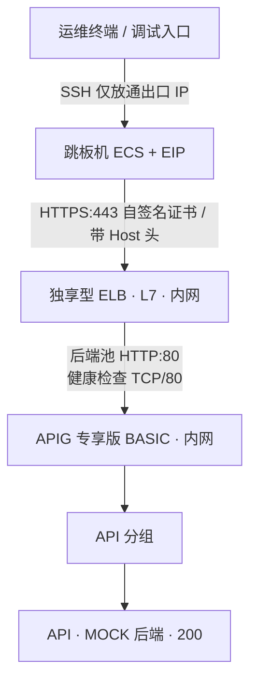

# cloud-native-security-private-api-gateway · 私网 API 网关经内网七层负载均衡暴露 · 华为云实践


## 1. 简介 / Overview

### 简介


本实践给出一种在华为云上构建「**API 网关零公网入口、仅能经内网七层负载均衡访问**」的参考实现。

解决的问题：某些业务要求 API 网关绝不暴露到公网，外部调用方只能走一条私网链路进入。本方案用**独享型弹性负载均衡（L7 / 内网 / HTTPS）**作为唯一入口，后端挂**API 网关专享版实例（仅内网）**，再经 API 分组路由到 MOCK 后端，端到端 HTTPS。

适用对象：需要在华为云上落地「私网 API 网关」模式的架构师、运维、以及想理解 APIG 专享版内网入口与 ELB Host 透传机制的工程师。

---

## 2. 目录

- [1. 简介 / Overview](#1-简介--overview)
- [2. 目录](#2-目录)
- [3. 架构图](#3-架构图)
- [4. 方案亮点](#4-方案亮点)
- [5. 涉及云服务](#5-涉及云服务)
- [6. 前置条件](#6-前置条件)
- [7. 快速开始](#7-快速开始)
- [8. 分步部署](#8-分步部署)
- [9. 使用方法 / 验证](#9-使用方法--验证)
- [10. 清理资源](#10-清理资源)
- [11. 详细说明](#11-详细说明)
- [12. 依赖](#12-依赖)
- [13. FAQ / 故障排除](#13-faq--故障排除)
- [14. 贡献指南](#14-贡献指南)
- [15. 许可证](#15-许可证)
- [16. 联系方式 / 维护者](#16-联系方式--维护者)

---

## 3. 架构图



整条链路对外只有一个入口：ELB 的内网 IP。API 网关实例不绑 EIP，无公网入口；其内网入口地址由 `huaweicloud_apig_instance` 直接导出（`vpc_ingress_address`）。

---

## 4. 方案亮点

- **零公网入口的 API 网关**：专享版实例部署在用户 VPC 子网内，不绑 EIP 即为纯内网，无需额外的私网接入资源。
- **客户端→ELB 为 HTTPS、ELB→APIG 为内网 HTTP**：ELB 监听器 HTTPS:443 使用证书（本实践为自签名，生产替换为可信 CA）终结 TLS；APIG 内网入口仅 80 开放（443 须绑证书才监听），故回源走 HTTP:80，VPC 内这一跳明文足够。
- **Host 头透传**：监听器 `forward_host = true`，把客户端原始 Host 透传给 APIG；APIG 靠 Host 路由到 API 分组，链路无歧义。
- **健康检查用 TCP/80**：只验证 APIG 内网入口端口在监听，不依赖 Host 路由，避开「HTTPS 需绑证书」「HTTP 健康检查 Host 头未被采纳」等坑；真正的 200 由调用方 `curl`（带 `-k` 与 Host 头）端到端验证。
- **来源收敛**：独享型 ELB 无安全组概念，访问控制下沉为监听器级 IP 地址组白名单（`ip_group`），用于限制可访问监听器的来源网段。
- **规格写死、可复现**：ELB 规格按名称精确锁定（`L7_flavor.elb.s1.small`），禁止数据源下标随机选型。

---

## 5. 涉及云服务

本实践使用以下华为云服务：

| 服务 | 用途 |
|---|---|
| VPC | 客户端 / 跳板机 / APIG 子网 |
| ECS（弹性云服务器） | VPC 内验证用跳板机 |
| 独享型 ELB（弹性负载均衡） | 内网 L7/HTTPS 唯一入口 |
| API 网关（APIG）专享版 | 私有 API 网关实例 |
| EIP（弹性公网 IP） | 跳板机出网（SSH 登录） |

---

## 6. 前置条件

- **账号与权限**：拥有 `cn-south-1`（华南-广州）区域的部署权限，且可创建 VPC、APIG 专享版、ELB、ECS、EIP。
- **CLI 工具**：
- Terraform `>= 1.4.0`（本实践使用 `1.x`，建议 1.5+）
- `huaweicloud` Provider `>= 1.90.0`（本实践锁定 1.96.1）
- `tls` Provider `>= 4.0.0`、`random` Provider `>= 3.5.0`
- **访问密钥配置**：AK/SK 通过环境变量提供，请勿写入任何文件（详见下方快速开始）。
- **区域约束**：APIG 专享版与 ELB 的规格目录按区域略有差异；可用区数量是 ELB 规格乘数，默认单 AZ。

---

## 7. 快速开始

```bash
# 1) 配置访问密钥 AK/SK（仅当前 shell 生效）
export HW_ACCESS_KEY="<HW_ACCESS_KEY>"
export HW_SECRET_KEY="<HW_SECRET_KEY>"
export HW_REGION_NAME="cn-south-1"

# 2) 进入目录并初始化
cd infra
terraform init

# 3) 预览（可选）
terraform plan

# 4) 部署
terraform apply

# 5) 取验证命令
terraform output verify_command
```

> 凭据一律用占位符 `<HW_ACCESS_KEY>` / `<HW_SECRET_KEY>` 表示，真实值绝不写入文件或文档。

---

## 8. 分步部署

1. **准备 `terraform.tfvars`**（已在仓库内，含 `region`、`name_prefix`、跳板机 SSH 来源网段）：
```hcl
region = "cn-south-1"
name_prefix = "cf2privapi"
bastion_ssh_source_cidr = "<你的出口 IP>/32" # 必须显式指定，不接受 0.0.0.0/0
```
2. **`terraform init`** —— 拉取 `huaweicloud` / `tls` / `random` Provider。
3. **`terraform plan`** —— 预期约 26 个资源（含跳板机）。重点确认：
- `huaweicloud_apig_instance.this` 未设置 `eip_id`（保持私有）；
- `huaweicloud_elb_loadbalancer.this` 的 `l7_flavor_id` 命中唯一规格；
- `huaweicloud_compute_instance.bastion` 镜像架构为 `x86`（与 s6.small.1 一致）。
4. **`terraform apply`** —— APIG 专享版实例创建约 20–30 分钟，请耐心等待；ELB / ECS 较快。
5. **查看输出**：`terraform output`（见[使用与验证](#使用与验证)）。

---

## 9. 使用方法 / 验证

### 使用方法与验证


部署完成后，在**跳板机**（VPC 内）执行验证命令，确认链路端到端打通：

```bash
# 正例：经内网 ELB 访问 MOCK API
$(terraform output -raw verify_command)
# 即：
# curl -sS -k -i -H 'Host: <分组调试域名>' https://<ELB 内网 IP>/hello

# 反例：直连 APIG 内网入口也应通（证明网关确实内网可达）
$(terraform output -raw negative_check_command)
```

预期返回：

```
HTTP/1.1 200 OK
...
{"message": "Hello from API GW"}
```

关键输出含义：

| 输出 | 说明 |
|---|---|
| `apig_private_ingress_address` | APIG 内网入口地址（ELB 后端挂的就是它） |
| `api_group_domain` | API 分组调试域名，**调用时必须作为 Host 头带入** |
| `elb_private_ip` | 内网 ELB 的私网 IP，对外唯一入口 |
| `apig_public_ingress_address` | 应为空；非空即说明网关被误绑 EIP，架构约束被破坏 |
| `bastion_public_ip` / `bastion_password` | 跳板机登录信息（password 为 sensitive） |

部署完成后请按本节步骤自行验证，确认业务功能可用，方可视为交付完成。

---

## 10. 清理资源

调试完成务必销毁，释放本次部署的资源：

```bash
cd infra
terraform destroy
```

> `destroy` 后建议到控制台确认 APIG 专享版实例与 ELB 已从云端移除（`terraform destroy` 的 `0 destroyed` 不等于云端干净，需控制台/API 直查）。APIG 实例删除需数分钟，耐心等待。

---

## 11. 详细说明

- **为什么不需要独立的「私网接入层」**：APIG 专享版实例本身就创建在用户 VPC 子网内并导出 `vpc_ingress_address`，直接作为 ELB 后端即可，无需额外端点资源。
- **Host 头路由**：APIG 靠 Host 头把请求路由到 API 分组。ELB 转发若丢失原 Host，网关会返回 `APIG.0101`。本实践用监听器 `forward_host = true` 透传，且调用方必须带 `Host: <分组调试域名>`。
- **后端成员固定走 IP 型注册**：`huaweicloud_elb_loadbalancer.this.cross_vpc_backend` 已固定为 `true`，成员 `subnet_id` 必须留空（纯 IP 注册），`huaweicloud_apig_instance.this.vpc_ingress_address`（如 `192.168.0.241`）即后端地址、回源端口 80。**一旦给成员填了 `subnet_id` 会触发 `ELB.8902` 且健康检查永久 `OFFLINE`**，这是本实践踩过的关键坑。
- **访问控制位置变化**：独享型 ELB 无安全组，来源收敛靠监听器绑定 IP 地址组（`huaweicloud_elb_ipgroup` + `listener.ip_group`）。反向（ELB→APIG）收敛由 APIG 实例安全组承担。
- **自签名证书**：本实践无域名、无证书，HTTPS 用 `tls` Provider 生成自签名证书打通链路，客户端须 `curl -k`。**生产环境必须替换为可信 CA 证书。**
- **调试资源不过夜**：所有资源在验证后立即 `destroy`。

---

## 12. 依赖

- 主要依赖：`huaweicloud` Provider、`tls` Provider、`random` Provider。
- 参考：华为云 APIG 与 ELB 官方文档。

---

## 13. FAQ / 故障排除

### FAQ


| 现象 | 原因 | 处理 |
|---|---|---|
| 调用返回 `APIG.0101` | 未带 `Host` 头，或 ELB 未透传 Host | 调用时加 `-H 'Host: <分组调试域名>'`；确认监听器 `forward_host = true` |
| 后端健康检查一直 `OFFLINE` | ① 成员填了 `subnet_id`（`cross_vpc_backend=true` 时须留空，否则 `ELB.8902` + 永久 `OFFLINE`）；② APIG 443 未绑证书不监听，须探 80 | 确认 member `subnet_id=null`、健康检查 `protocol=TCP` 且探 80；`curl -k -H Host` 端到端验证 200 |
| ECS 创建失败 / 架构不匹配 | 镜像命中 ARM 版而规格是 x86 | 确认 `bastion_image_architecture = "x86"` 且镜像唯一命中 |
| 跳板机创建失败 | `bastion_ssh_source_cidr` 留空或为 `0.0.0.0/0` | 显式设为你的出口 IP/32 |
| `apig_public_ingress_address` 非空 | 网关被误绑 EIP | 检查 `apig_bind_eip` 必须为 `false` |

---

## 14. 贡献指南

欢迎提交 Issue 反馈问题或改进建议。请通过项目 Issue 渠道提交反馈。

---

## 15. 许可证

本实践采用 **MIT No Attribution** 许可证，详见仓库根目录 [`LICENSE`](LICENSE) 文件。

---

## 16. 联系方式 / 维护者
| 项 | 内容 |
|---|---|
| **创建者** | [dgc-git](https://github.com/dgc-git) |
| **维护者** | [dgc-git](https://github.com/dgc-git) |
| **联系方式** | GitHub Issues / PR（见[第 14 节](#14-贡献指南)） |
